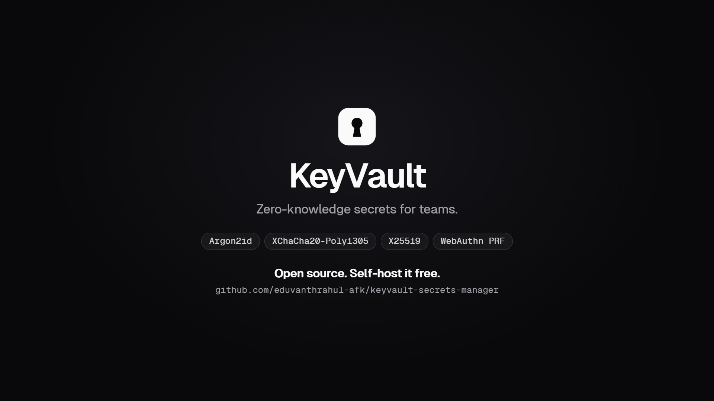
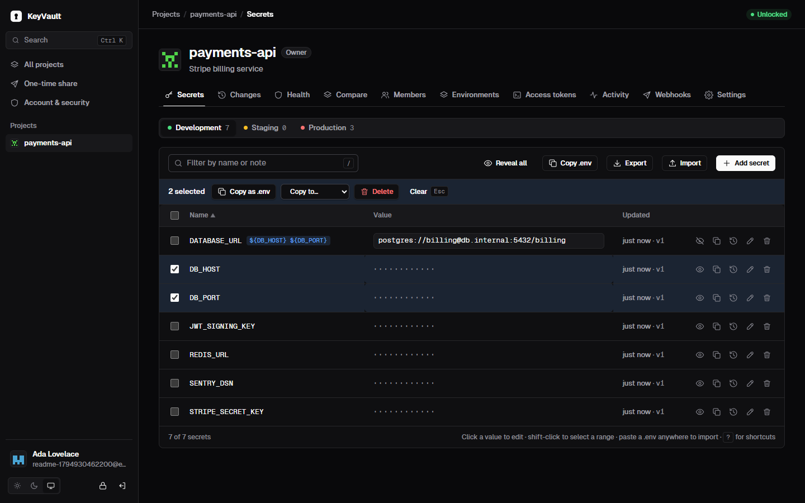
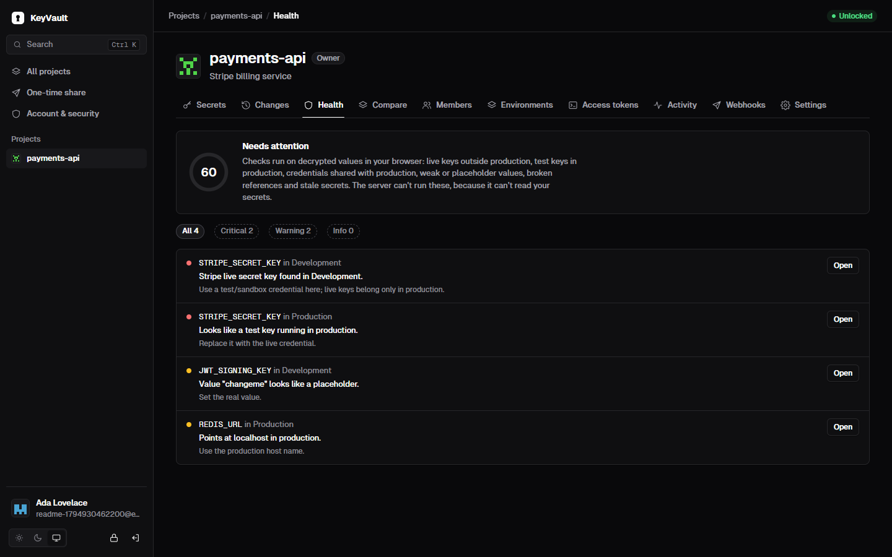
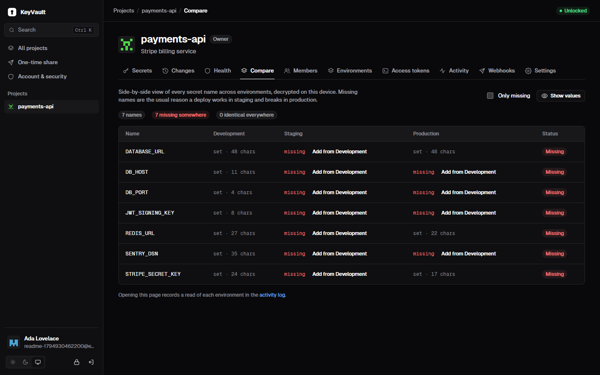
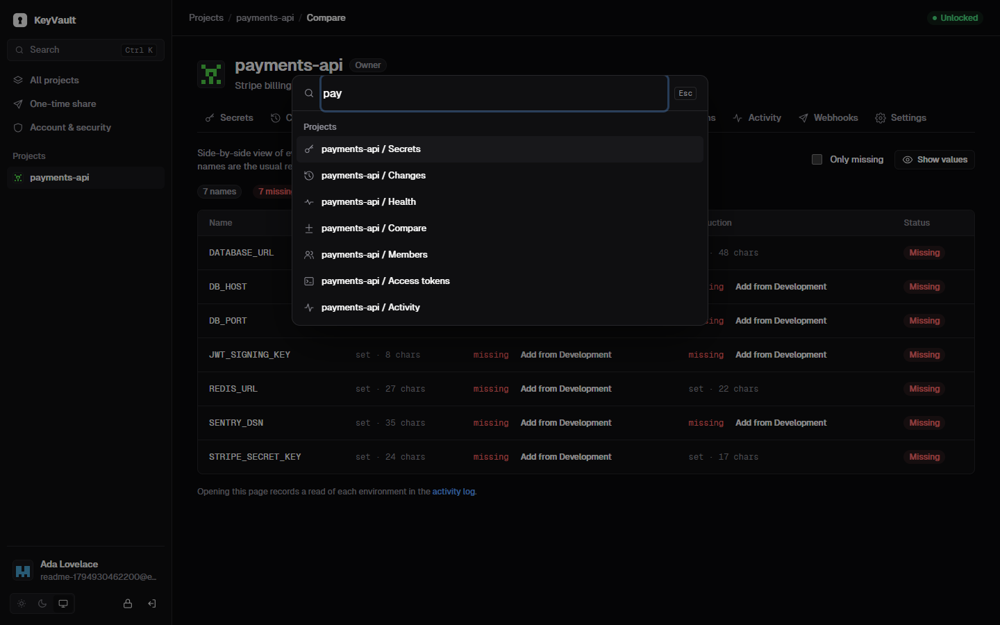
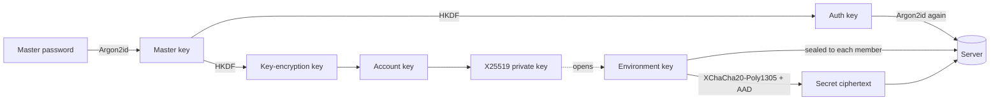

<div align="center">

# KeyVault

**Open-source, zero-knowledge secrets management for teams.**
Your server stores ciphertext. Nothing else.

[](https://github.com/eduvanthrahul-afk/keyvault-secrets-manager/actions/workflows/ci.yml)


[](docs/media/keyvault-launch.mp4)

▶ [Watch the 20-second launch video](docs/media/keyvault-launch.mp4) · [vertical cut](docs/media/keyvault-launch-vertical.mp4)

</div>

---

KeyVault stores your team's API keys and environment variables **encrypted in the browser and the CLI** before they leave your machine. Share them per environment, require reviews for production, inject them into CI without a `.env` file, and keep a tamper-evident record of every read, all without trusting the server or the database.

> A full dump of KeyVault's database yields ciphertext, wrapped keys and one-way verifiers. Nothing in it decrypts a secret.

## Screenshots

| Secrets: inline editing, references, bulk actions | Health check: catches mistakes on decrypted values |
|---|---|
|  |  |
| **Compare environments: what's missing where** | **Command palette (⌘K / Ctrl+K)** |
|  |  |

## Features

**Security**
- **End-to-end encryption.** Names, values and notes are encrypted client-side with XChaCha20-Poly1305. Each value is bound to its project, environment, secret and field, so a malicious server can't move a production value into development without decryption failing.
- **Cryptographic access control.** Every environment has its own key, sealed to each member's X25519 public key. Roles decide what the server allows; keys decide what you can decrypt.
- **Zero-knowledge key rotation.** When someone leaves, an admin's browser re-encrypts every secret *and its whole history* under a fresh key, and the server swaps it in atomically.
- **Passkey unlock (WebAuthn PRF).** Unlock with Touch ID or Windows Hello. The key is derived inside your device.
- **Account security.** TOTP 2FA with replay protection and recovery codes, an Emergency Kit recovery key, revocable server-side sessions, and an auto-locking in-memory vault.
- **Tamper-evident audit log.** Every read and change is hash-chained; verify the whole history in one click.

**Team workflow**
- **Protected environments and change requests.** Developers propose; a *different* admin reviews a diff decrypted in their own browser and approves. Stale requests become conflicts instead of overwriting.
- **Secret references.** `DATABASE_URL=postgres://app@${DB_HOST}:${DB_PORT}/db`, resolved after decryption in both the browser and the CLI, with cycle detection.
- **Health check.** Flags live Stripe/AWS/GitHub keys outside production, test keys in production, credentials shared with production, placeholders, `localhost` in production and stale secrets. The checks run on decrypted values, which the server can't see.
- **Environment compare.** See which variables are missing in production *before* the deploy fails, and copy them across with one click (re-encrypted for the target environment).
- **Versions and rollback** with optimistic concurrency: concurrent edits are rejected, not lost.

**Developer experience**
- **`kv` CLI.** `kv run -- npm start` decrypts in memory and injects secrets into the process without writing anything to disk; `kv doctor` fails CI on critical findings.
- **CI/CD access tokens.** Read-only, environment-scoped and expiring. The server stores only a hash and a wrapped key it can't open.
- **Signed webhooks.** Redeploy when secrets change, with HMAC signatures, retries with backoff and SSRF protection.
- **Fast UI.** Click-to-edit values, multi-select with shift-click, undo for deletes, paste a `.env` anywhere to import, keyboard shortcuts (`/` `n` `i` `r` `?`), light and dark themes.
- **One-time share links.** Burn-after-reading, with the key kept in the URL fragment (never sent to the server).

## How it works



| Layer | Primitive |
|---|---|
| Password stretching | Argon2id (64 MiB, t=3) in a Web Worker; the client refuses weak server-supplied parameters |
| Key derivation | HKDF-SHA256, with separate branches for login and encryption |
| Encryption | XChaCha20-Poly1305, AAD binds project, environment, secret and field |
| Sharing | X25519 sealed boxes, plus identicons and fingerprints for out-of-band verification |
| Unlock | WebAuthn PRF passkeys |
| Sessions | Opaque `__Host-` cookie, HttpOnly, Secure, SameSite=Strict; only its hash is stored |
| Libraries | Audited `@noble/*` (same code in the browser and the CLI), `hash-wasm` |

Read the full threat model, including the honest limitations, in **[docs/SECURITY.md](docs/SECURITY.md)**.

## Tech stack

| | |
|---|---|
| **Backend** | Java 21, Spring Boot 3.5, Spring Security, PostgreSQL, Flyway, JdbcClient (explicit SQL), Bucket4j, Caffeine, Micrometer/Prometheus |
| **Frontend** | React 18, TypeScript, Vite, TanStack Query, Geist |
| **Crypto** | One shared TypeScript package used by both the web app and the CLI |
| **CLI** | Node.js, no runtime dependencies beyond the crypto package |
| **Testing** | Vitest, JUnit with embedded PostgreSQL, Playwright, k6 |
| **Ops** | Docker (one image serves the API and the UI), GitHub Actions, Prometheus and Grafana |

## Quick start

Requirements: **Java 21** and **Node 20+**. PostgreSQL is optional locally: the dev server starts an embedded instance.

```bash
git clone https://github.com/eduvanthrahul-afk/keyvault-secrets-manager.git
cd keyvault-secrets-manager
npm install
npm run build:web      # builds the UI into the server's static folder
npm run dev:server     # API + UI on http://localhost:8080 with embedded PostgreSQL
```

For hot-reloading UI work, also run `npm run dev:web` and open http://localhost:5173.

### CLI

```bash
npm run build:cli && npm install -g ./apps/cli
export KEYVAULT_URL=http://localhost:8080
export KEYVAULT_TOKEN=kvs_…            # Project → Access tokens

kv run -- npm start                    # inject secrets into a process
kv export --format dotenv              # or json / shell
kv get DATABASE_URL
kv doctor                              # exit code 2 on critical findings
```

## Deploy

One container serves both the API and the UI (same origin, so no CORS). You need PostgreSQL and HTTPS.

```bash
cp .env.example .env    # set DATABASE_PASSWORD and KEYVAULT_SERVER_KEY (openssl rand -base64 32)
docker compose up -d
docker compose --profile monitoring up -d   # optional Prometheus + Grafana dashboard
```

It runs on free tiers: a Docker web service (Render, Koyeb, Fly.io) plus free PostgreSQL (Neon, Supabase). See [docs/ARCHITECTURE.md](docs/ARCHITECTURE.md#deployment).

## Testing

| Suite | What it covers | Command |
|---|---|---|
| Crypto (30) | Round trips, tampering, ciphertext substitution, KDF downgrade, public-key substitution, references, health rules | `npm test` |
| CLI (6) | Local decryption, safe process spawning on Windows | `npm test` |
| API (22) | Real PostgreSQL: auth, CSRF, RBAC, versioning, rotation, audit-chain tampering, change requests, signed webhooks, SSRF | `cd apps/server && ./mvnw verify` |
| End-to-end (19 checks) | Two users, sharing, the CLI binary, rotation, token revocation | `npm run e2e` |
| Browser (9) | Full UI flows, passkeys via a virtual authenticator, phone layout, no CSP violations | `npm run test:ui` |

**Performance** (`npm run load:bench`, 32 connections, 60 secrets per response, single laptop):

| Scenario | Throughput | p95 |
|---|---|---|
| CI token fetch | 621 req/s | 68 ms |
| Developer list | 646 req/s | 60 ms |

The first load test managed 20 req/s with a 1.9 s p95. Profiling found that audit-log appends serialised every read in a project; reads are now batched per chain while writes stay transactional. Details in [ARCHITECTURE.md](docs/ARCHITECTURE.md#audit-write-path).

## Project structure

```
packages/crypto   Shared crypto: the security core (browser + CLI)
apps/server       Spring Boot API, Flyway migrations, integration tests
apps/web          React UI
apps/cli          kv command-line tool
tests/ui          Playwright browser tests
scripts/          End-to-end script and load tests (k6 + Node bench)
monitoring/       Prometheus config and Grafana dashboard
docs/             Security model, architecture, media
```

## License

[MIT](LICENSE)
