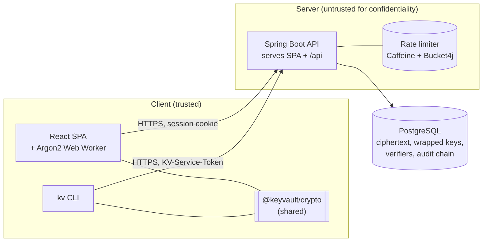
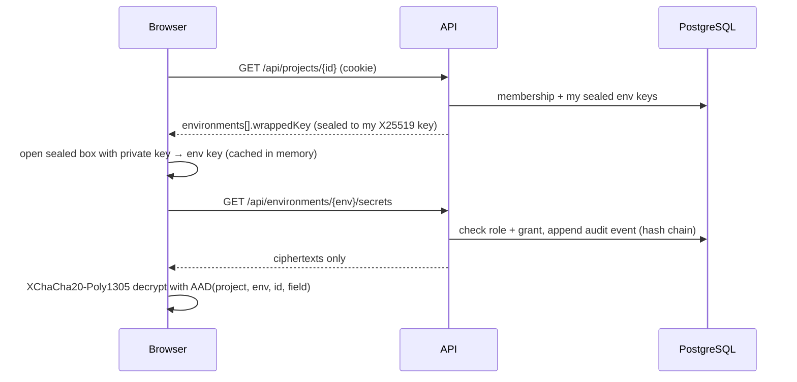

# Architecture

## Components



**One shared crypto package** is the most important design decision. The browser and the CLI run byte-identical encryption code, so there is a single implementation to review and test, and it is tested against attack cases (slot swapping, KDF downgrade, key substitution, tampering).

**One deployable.** The SPA is built into the server's `static/` folder. Same origin means no CORS configuration, cookies stay `SameSite=Strict`, and a free-tier host only has to run one container.

## Request flow: reading a secret



## Backend structure (feature packages)

| Package | Responsibility |
|---|---|
| `auth` | prelogin, register, login + MFA, recovery, opaque sessions, CSRF guard, TOTP |
| `account` | profile, password change, 2FA, sessions, activity, account deletion |
| `project` | projects, environments, members, grants; `AccessService` = single authorisation point |
| `secret` | CRUD, versions, rollback, zero-knowledge key rotation |
| `token` | machine identities and the `/api/v1/service` endpoint |
| `audit` | hash-chained append-only log + verification |
| `send` | one-time encrypted links |
| `common` | problem-detail errors, rate limiter, codecs, server-side crypto |

Design choices worth calling out:

- **Explicit SQL via `JdbcClient`, not JPA.** The interesting operations are concurrency-sensitive: `UPDATE … WHERE version = ? RETURNING` (optimistic locking), `SELECT … FOR UPDATE` (rotation, audit chain head), and `UPDATE … WHERE view_count < max_views RETURNING` (atomic burn-after-read). Writing them as SQL makes the guarantees visible and avoids N+1 queries.
- **Flyway migrations** with `ON DELETE` rules chosen deliberately. Audit events have no foreign key to projects, so the trail outlives deleted projects.
- **404 instead of 403 for non-members**, so ids cannot be probed.
- **Records instead of Lombok** (Java 21), and **virtual threads** enabled.
- **Problem Details (RFC 9457)** for every error.

## Data model

```
users ─┬─< sessions
       ├─< totp_recovery_codes
       ├─< project_members >── projects ─< environments ─┬─< environment_key_grants >── users
       └─< sends                                         ├─< secrets ─< secret_versions
                                                         └─< service_tokens
audit_chain_heads ─< audit_events      (keyed by "project:<id>" / "user:<id>")
```

## Concurrency guarantees

| Scenario | Mechanism |
|---|---|
| Two people edit the same secret | `expectedVersion` → 409 for the loser; UI asks to reload |
| Two people create the same name | env row lock + blind-index unique constraint → 409 |
| Edit during key rotation | rotation locks the env row; writes with an old `keyVersion` get 409 `stale_key` |
| Two rotations at once | `expectedKeyVersion` compare-and-swap |
| Two viewers open a 1-view link | single atomic `UPDATE … RETURNING` |
| Concurrent audit writes | per-chain head row locked `FOR UPDATE` |

## Observability

`/actuator/prometheus` (bearer-token protected) exports:

| Metric | Labels | Why |
|---|---|---|
| `keyvault_auth_logins_total` | `result` = success / failure / mfa_failure | brute-force and credential-stuffing detection |
| `keyvault_rate_limited_total` | `policy` | which limiter is firing |
| `keyvault_secrets_reads_total` | `via` = user / service_token | CI load vs. humans |
| `keyvault_secrets_writes_total`, `keyvault_keys_rotations_total`, `keyvault_auth_passkey_unlocks_total` | | activity |
| `http_server_requests_seconds_*` | `uri`, `status` | latency histograms (p95/p99) |

`docker compose --profile monitoring up` starts Prometheus and Grafana with the dashboard in `monitoring/grafana/dashboards/keyvault.json` provisioned.

## Webhook delivery (transactional outbox)

```
secret update ──same transaction──► INSERT webhook_deliveries (PENDING)
dispatcher (every 2s):  SELECT … WHERE due FOR UPDATE SKIP LOCKED LIMIT 25  → lease (next_attempt = now+2m), commit
                        POST outside any transaction (10s timeout, no redirects)
                        2xx → SUCCEEDED   else → PENDING with backoff 30s·2ⁿ (max 6h), FAILED after 8 attempts
```

An event exists if and only if the change committed (no dual-write problem), and `SKIP LOCKED` lets several instances share the queue without double delivery.

## Audit write path

Mutations call `AuditService.record()` inside their own transaction, so a change and its audit event commit together or not at all. Reads, which are about 95% of traffic, call `recordAsync()`: events go into a bounded in-memory queue and are appended every 250 ms in one transaction per chain (one `FOR UPDATE` on the chain head per batch, not per request). The queue is drained before the log is listed or verified and on shutdown; if it is full, the event is written synchronously instead of being dropped. The tradeoff is that a hard crash can lose up to 250 ms of *read* events; it can never lose a mutation's event.

## Load testing

`npm run load:seed` creates an account, a project with 60 encrypted secrets and an access token. `scripts/load/k6.js` runs two constant-arrival-rate scenarios (CI token fetch at 150 req/s, developer listing at 50 req/s) with p95 thresholds; `npm run load:bench` runs the same paths with a dependency-free Node client when k6 isn't installed.

## Scaling path

The current build targets a single instance (it fits free tiers). Per component:

| Concern | Now | At scale |
|---|---|---|
| Rate limits, MFA challenges | in-memory Caffeine | Bucket4j on PostgreSQL/Redis; challenges in a table |
| Sessions | PostgreSQL | unchanged (indexed by token hash), add a read-through cache |
| Audit chain contention | one chain per project | already partitioned per project; anchor heads externally |
| Static assets | served by Spring | CDN in front (hashed filenames are immutable) |
| DB | single PostgreSQL | read replicas for list endpoints; all writes are short transactions |

## Deployment

Needs: one container (Java 21, about 300 MB RAM), PostgreSQL 14+, HTTPS.

| Variable | Purpose |
|---|---|
| `DATABASE_URL` | JDBC URL, e.g. `jdbc:postgresql://host/db?sslmode=require` |
| `DATABASE_USERNAME` / `DATABASE_PASSWORD` | DB credentials |
| `KEYVAULT_SERVER_KEY` | `openssl rand -base64 32` |
| `KEYVAULT_APP_ORIGIN` | public URL, e.g. `https://keyvault.example.com` |
| `FORWARD_HEADERS_STRATEGY` | `framework` behind a trusted proxy (most PaaS), else `none` |
| `KEYVAULT_REGISTRATION_ENABLED` | `false` for a private instance |

Free combination: a Docker-capable free web service (Render, Koyeb, Fly.io) and a free PostgreSQL (Neon or Supabase). Health check path: `/actuator/health`.
